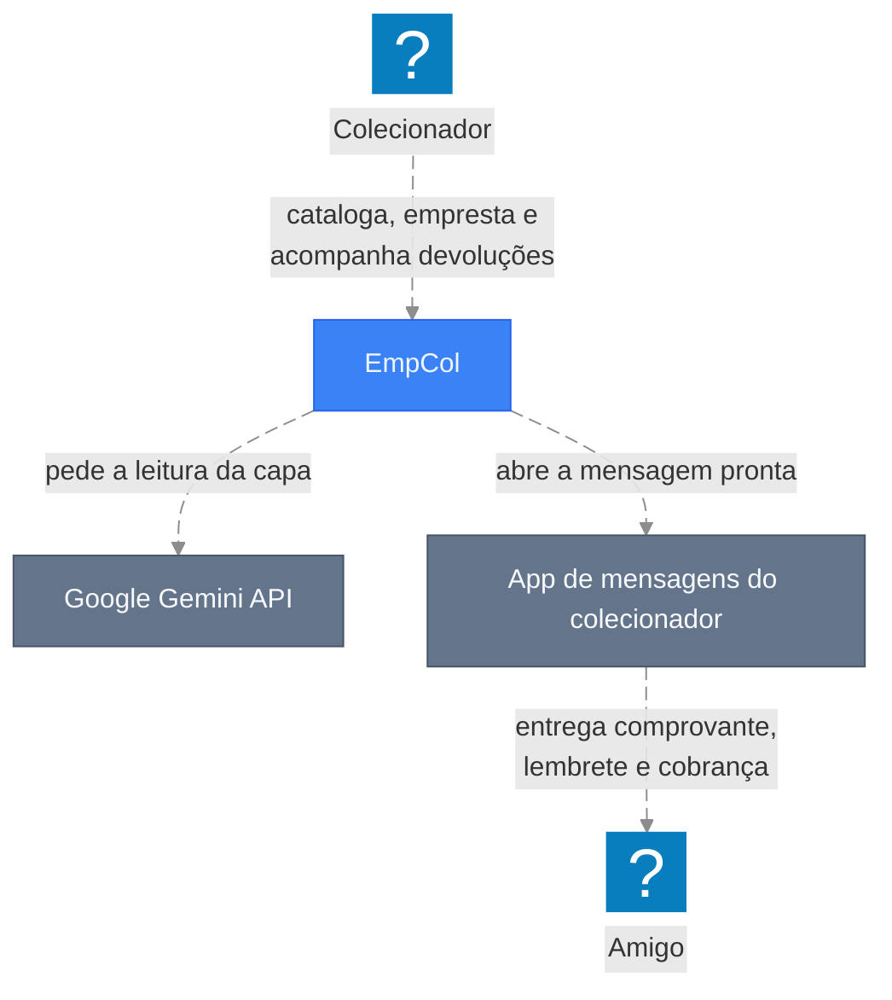
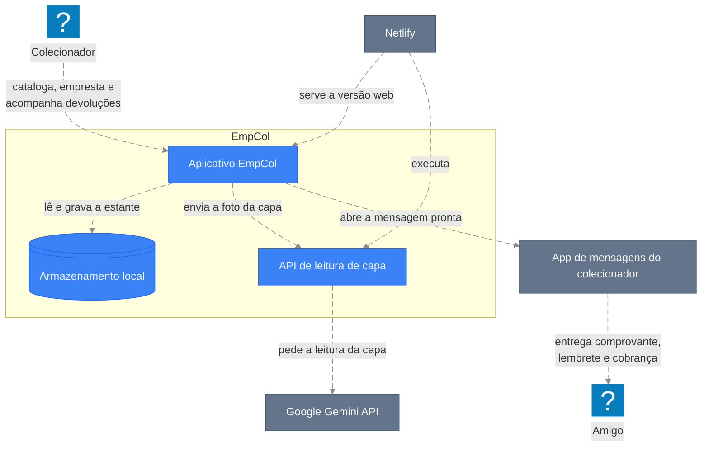

# Arquitetura (LikeC4)

Modelo C1 (contexto) e C2 (containers) do EmpCol, em [`empcol.c4`](empcol.c4). O modelo reflete o código em `src/` e as decisões dos ADRs 0001 a 0004; a CI valida o modelo a cada Pull Request.

**Ver os diagramas interativos:** `npx likec4 start architecture` (na raiz do repositório).

As imagens abaixo foram geradas do modelo com `npx likec4 gen mermaid architecture`. Se o modelo mudar, gere de novo.

## C1 · Contexto

O colecionador usa o EmpCol para catalogar e emprestar. O EmpCol depende de dois sistemas externos: o Gemini, que lê a capa, e o aplicativo de mensagens do próprio colecionador, que leva o comprovante e os lembretes ao amigo.

## C2 · Containers

| Container | Tecnologia | Papel |
| :--- | :--- | :--- |
| Aplicativo EmpCol | Expo (React Native), TypeScript, Expo Router, React Native Paper | Telas de estante, catalogar, edição e emprestar, para Android, iOS e web |
| Armazenamento local | AsyncStorage (localStorage na web) | Edições, empréstimos e amigos, só no aparelho |
| API de leitura de capa | Netlify Functions, TypeScript | `POST /api/ler-capa`: chama o Gemini com a chave guardada no servidor |

